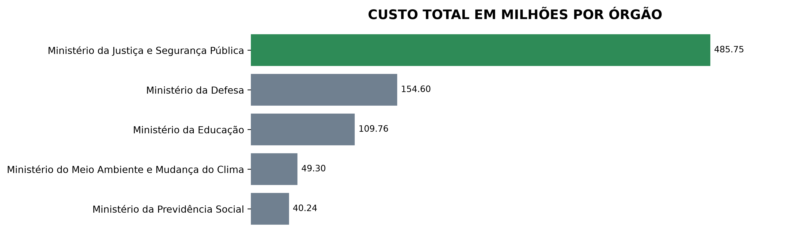
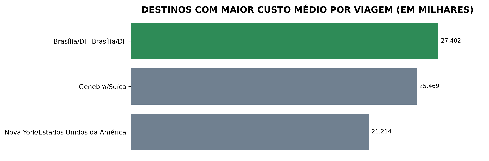
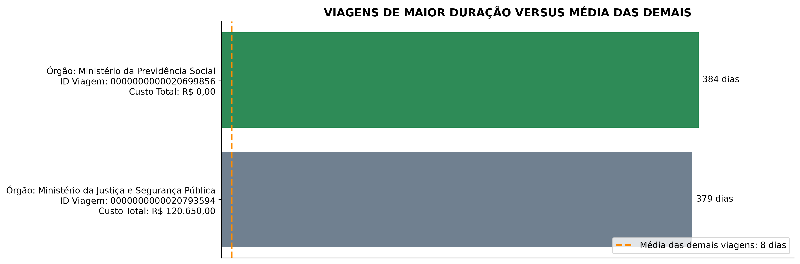
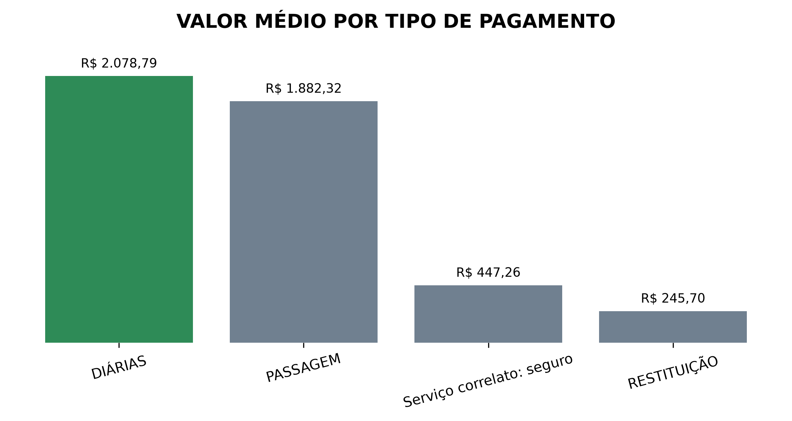
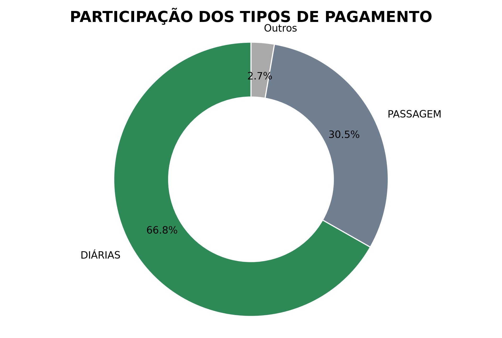
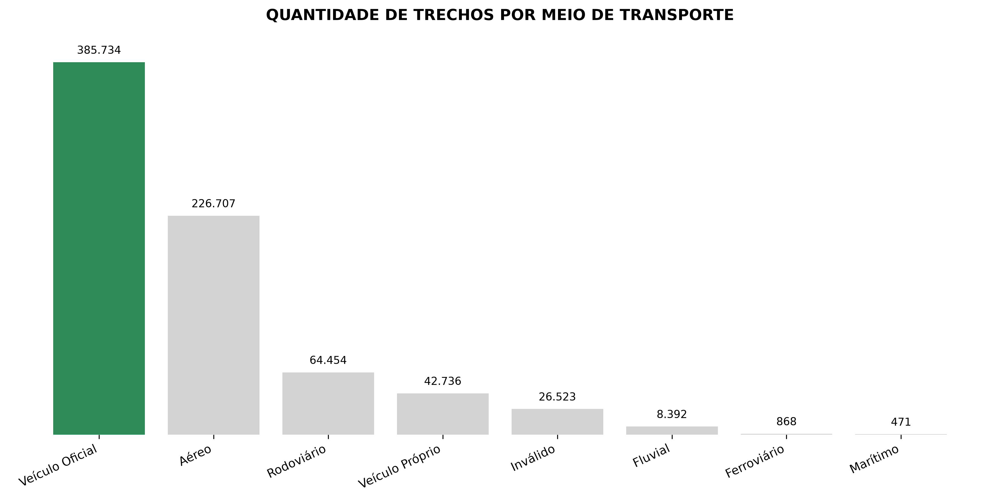
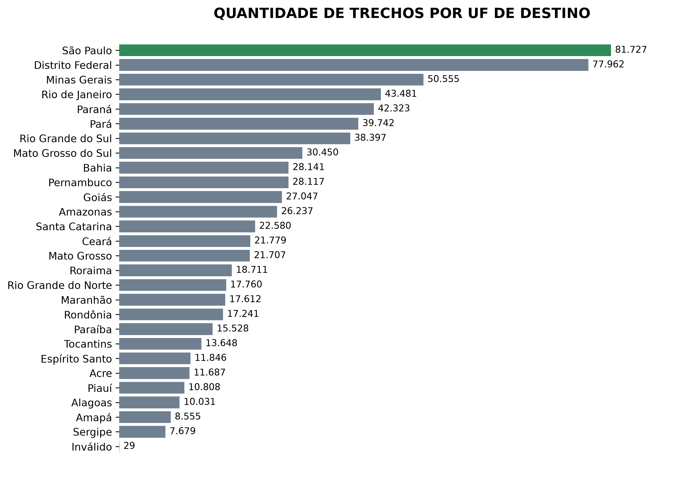
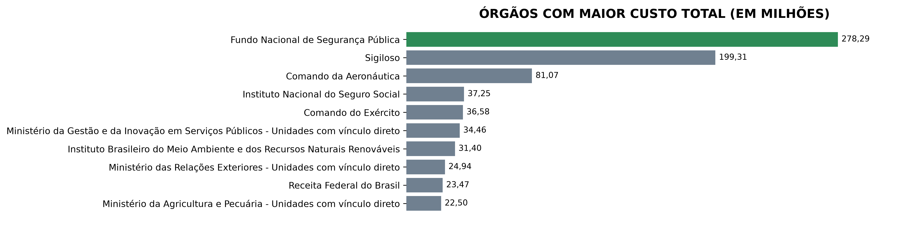

# 📊 Projeto Avaliativo - Análise de Dados com Python | Módulo 1
**Autor:** Felipe Busarello  
**Curso:** Análise de Dados com Python  
**Turma:** 09 - 2026  
**Professores:** Cláudio Neves e Luana Pereira

## 📌 Sobre o Projeto
Este projeto foi desenvolvido como parte do Projeto Avaliativo do Módulo 1 do curso de **Análise de Dados com Python**.

O objetivo é desenvolver um pipeline de dados utilizando **Python, PostgreSQL e técnicas de ETL (Extract, Transform, Load)**, desde a extração dos dados até o tratamento, a organização e a análise das informações.

O projeto utiliza dados de viagens, passagens, trechos e pagamentos referentes ao ano de 2025, disponibilizados em arquivos CSV.

A solução utiliza uma arquitetura de dados baseada nas camadas **Raw, Silver e Gold**, separando os dados brutos, os dados tratados e as informações preparadas para análise.

## 🎯 Objetivos

- Desenvolver um processo de ETL utilizando Python.
- Extrair dados a partir dos arquivos disponibilizados.
- Armazenar os dados de origem na camada Raw.
- Tratar e transformar os dados na camada Silver.
- Utilizar PostgreSQL para armazenamento e organização dos dados.
- Aplicar consultas SQL para responder perguntas de negócio.
- Desenvolver análises utilizando Python e SQL.
- Criar gráficos para apoiar a interpretação dos resultados.
- Validar os dados e as estruturas utilizadas nas análises.
- Documentar o processo e aplicar boas práticas de versionamento com Git e GitHub.

## 📊 Base de Dados

A base de dados contém informações relacionadas a viagens realizadas durante o período analisado. Inicialmente, os dados estão distribuídos em quatro arquivos CSV:

- `2025_Viagem.csv`
- `2025_Pagamento.csv`
- `2025_Passagem.csv`
- `2025_Trecho.csv`

As informações abrangem:

- Identificação das viagens e propostas.
- Órgãos envolvidos e viajantes.
- Períodos e destinos das viagens.
- Quantidade de diárias e respectivos valores.
- Passagens, pagamentos e trechos.
- Meios de transporte e deslocamentos.

Os arquivos CSV são utilizados localmente e não são versionados no GitHub.

## 🔎 Processo de ETL

O pipeline foi organizado em três camadas, com responsabilidades distintas.

```text
              Arquivos CSV
                   |
                   v
          +------------------+
          |       RAW        |
          |   Dados brutos   |
          +------------------+
                   |
                   v
          +------------------+
          |      SILVER      |
          |  Dados tratados  |
          +------------------+
                   |
                   v
          +------------------+
          |       GOLD       |
          | Dados agregados  |
          | para análise     |
          +------------------+
                   |
                   v
          Consultas, indicadores,
          gráficos e conclusões
```

### 1. Extração e camada Raw

A extração e a carga dos arquivos são realizadas por meio do script `1_extrair.py`.

A camada Raw tem como objetivo preservar os dados recebidos na origem, evitando alterações de conteúdo durante a extração.

As tabelas Raw utilizam colunas do tipo `VARCHAR`, permitindo armazenar os valores conforme disponibilizados nos arquivos de origem.

O processo contempla:

- Download e extração dos arquivos disponibilizados.
- Leitura dos arquivos CSV.
- Carga dos registros no PostgreSQL em blocos.
- Tratamento de exceções.
- Validação da quantidade de registros carregados.

### 2. Análise e qualidade dos dados

Antes da transformação, foi realizada uma análise exploratória das tabelas Raw para compreender a estrutura e identificar situações que exigiam atenção.

Entre os aspectos avaliados estão:

- Tipos e formatos dos dados.
- Campos vazios e representações de ausência.
- Formatos de datas e valores numéricos.
- Registros completamente duplicados.
- Unicidade de identificadores.
- Valores especiais e informações protegidas.
- Relacionamentos e repetição de registros entre tabelas.

#### Volume inicial dos dados

| Tabela | Registros | Colunas |
|---|---:|---:|
| `raw_viagem` | 341.860 | 22 |
| `raw_pagamento` | 606.916 | 10 |
| `raw_passagem` | 167.260 | 19 |
| `raw_trecho` | 763.349 | 14 |
| **Total** | **1.879.385** | - |

#### Principais resultados da análise

- A tabela `raw_viagem` possui 341.860 registros, e o campo `id_viagem` é único nos dados analisados.
- A tabela `raw_pagamento` apresenta registros completamente duplicados.
- A tabela `raw_passagem` apresenta 50 registros completamente duplicados.
- A tabela `raw_trecho` não apresentou registros completamente duplicados.
- A repetição de `id_viagem` nas tabelas de pagamentos, passagens e trechos é esperada, pois uma viagem pode estar relacionada a vários registros nessas tabelas.
- As datas de origem foram identificadas no formato `DD/MM/AAAA`.
- Os valores monetários utilizam vírgula como separador decimal.
- Foram encontrados valores como `Sem informação`, `Sigiloso`, `Informações protegidas por sigilo` e `Inválido`.
- Também foram identificados códigos como `-1` e `-11`, utilizados pela própria fonte para representar situações específicas.

#### Considerações sobre a qualidade dos dados

Nem todo valor que representa ausência de informação deve ser automaticamente convertido para `NULL`.

Valores como `Sem informação`, `Sigiloso`, `Informações protegidas por sigilo` e `Inválido` podem ter significados próprios na fonte. Por isso, as regras de transformação devem considerar o contexto e a natureza de cada campo.

A repetição de `id_viagem`, por sua vez, não é suficiente para justificar a exclusão de registros, pois representa um relacionamento esperado entre viagens, pagamentos, passagens e trechos.

### 3. Transformação e camada Silver

O processo de transformação é realizado pelo script `2_transformar.py`, responsável por tratar os dados da camada Raw e carregá-los nas tabelas Silver.

Entre os tratamentos aplicados estão:

- Limpeza e padronização de textos.
- Conversão de datas e valores numéricos.
- Criação de campos calculados.
- Definição de tipos de dados adequados.
- Relacionamentos entre tabelas.
- Aplicação de regras de integridade.

As tabelas Silver utilizam estruturas tipadas, chaves primárias, chaves estrangeiras e restrições de integridade, conforme definido para cada tabela.

#### Preservação dos registros de pagamento

Na transformação de `raw_pagamento` para `silver_pagamento`, não é realizada a remoção automática de duplicatas exatas.

Como a origem não possui um identificador próprio de pagamento que permita distinguir com segurança registros repetidos de lançamentos legítimos com os mesmos atributos, a igualdade entre todas as colunas não é considerada, isoladamente, evidência suficiente de erro.

Os pagamentos são mantidos independentemente da situação da viagem. O filtro de situação é aplicado posteriormente nas consultas analíticas que exigem exclusivamente viagens realizadas.

### 4. Análise e camada Gold

A camada Gold prepara os dados para responder perguntas de negócio. Nela são utilizadas consultas SQL que agregam informações das tabelas Silver e geram indicadores para análise.

As estruturas Gold utilizadas nas perguntas 4 a 7 são organizadas em tabelas e views correspondentes. A igualdade entre os resultados de cada tabela e sua respectiva view é verificada no notebook.

As análises consideram apenas viagens com situação **`Realizada`**, conforme a regra de negócio definida para o projeto.

## 📈 Perguntas de negócio e análises realizadas

As sete perguntas obrigatórias foram concluídas no notebook `3_analise.ipynb`, com consultas SQL, tabelas de resultados, gráficos e conclusões analíticas.

| Pergunta | Análise realizada | Visualização |
|---|---|---|
| **1** | Cinco órgãos com maior custo total de viagens | `pergunta_1_custo_total_por_orgao.png` |
| **2** | Três combinações de destinos com maior custo médio por viagem, considerando grupos com mais de 100 viagens realizadas | `pergunta_2_custo_medio_por_destino.png` |
| **3** | Duas viagens de maior duração, comparadas à duração média das demais viagens realizadas | `pergunta_3_duracao_viagens.png` |
| **4** | Comparação dos tipos de pagamento por quantidade, valor total e valor médio | `pergunta_4_valor_medio_por_tipo_pagamento.png` |
| **5** | Quantidade de trechos por meio de transporte, identificando os mais utilizados | `pergunta_5_quantidade_por_meio_transporte.png` |
| **6** | Quantidade de trechos por destino, identificando as UFs com maior ocorrência | `pergunta_6_quantidade_por_uf_destino.png` |
| **7** | Dez órgãos com maior custo total de pagamentos | `pergunta_7_custo_total_por_orgao.png` |

### 📊 Visualizações

Os gráficos foram desenvolvidos em Python com Matplotlib e salvos no diretório `Graficos/`.

#### Pergunta 1 - Custo total por órgão

Compara os cinco órgãos com maior custo total de viagens.



#### Pergunta 2 - Custo médio por destino

Compara o custo médio por viagem entre as três combinações de destinos selecionadas.



#### Pergunta 3 - Duração das viagens

Compara as duas viagens de maior duração com a média de duração das demais viagens realizadas.



#### Pergunta 4 - Valor médio por tipo de pagamento

Destaca o tipo de pagamento com maior valor médio. A análise também contempla a quantidade de pagamentos e a participação no valor financeiro total.




#### Pergunta 5 - Quantidade por meio de transporte

Apresenta a quantidade de trechos associados a cada meio de transporte.



#### Pergunta 6 - Quantidade por UF de destino

Apresenta os destinos com maior quantidade de trechos registrados.



#### Pergunta 7 - Custo total por órgão

Apresenta os dez órgãos com maior valor total de pagamentos, destacando o primeiro colocado.



### 📝 Observações metodológicas

- **Pergunta 2:** a coluna `destinos` pode conter várias cidades no mesmo texto. O agrupamento representa combinações textuais de destinos, não necessariamente cidades individuais.
- **Pergunta 3:** a viagem de maior duração apresentou custo total igual a zero, enquanto a segunda apresentou custo de R$ 120.650,00. O valor zero foi sinalizado como ponto de atenção, sem presumir que seja um erro de preenchimento.
- **Pergunta 4:** o valor médio é calculado por registro de pagamento. A análise também compara quantidade de pagamentos e valor financeiro total.
- **Perguntas 5 e 6:** as contagens consideram os trechos associados às viagens realizadas. Categorias presentes nos dados, como `Inválido`, são mantidas quando não são excluídas explicitamente pelas consultas.
- **Pergunta 7:** o ranking utiliza o valor total dos pagamentos associados a cada órgão nas viagens realizadas. O gráfico apresenta os dez primeiros colocados.

## 💡 Principais aprendizados

O desenvolvimento do projeto permitiu aplicar, de forma integrada, diferentes etapas do trabalho com dados:

- Extração e carga de arquivos CSV utilizando Python.
- Organização dos dados em um banco PostgreSQL.
- Separação entre dados brutos, tratados e preparados para análise.
- Identificação de valores ausentes, duplicidades e particularidades da fonte.
- Conversão e validação de tipos de dados.
- Construção de consultas SQL com agregações, filtros, agrupamentos e relacionamentos.
- Criação de indicadores e gráficos com Python.
- Validação de tabelas e views da camada Gold.
- Documentação e versionamento do código utilizando Git e GitHub.

As análises também reforçam a importância de interpretar os dados de acordo com seu contexto. Um valor incomum ou um registro repetido não deve ser considerado automaticamente um erro sem avaliar sua origem e seu significado.

## 🧠 Reflexão sobre ETL e qualidade dos dados

O projeto demonstra a importância de estruturar o processo de dados em etapas bem definidas.

A camada Raw preserva os registros de origem, permitindo rastrear os dados recebidos. A camada Silver aplica os tratamentos e as regras de integridade necessárias. A camada Gold organiza as informações em consultas e indicadores direcionados às perguntas de negócio.

Essa separação facilita a manutenção do pipeline, a identificação de problemas e a validação dos resultados. Também permite que as decisões analíticas sejam documentadas e reproduzidas.

A análise de dados exige não apenas escrever consultas e criar gráficos, mas também compreender as limitações da fonte, validar os resultados e comunicar as conclusões com clareza.

## 🛠️ Tecnologias e técnicas utilizadas

### Linguagens
- Python
- SQL

### Banco de dados
- PostgreSQL

### Bibliotecas e ferramentas
- Pandas
- Psycopg2
- Matplotlib
- Requests
- BeautifulSoup4
- Jupyter Notebook
- VS Code
- Git
- GitHub

### Técnicas
- ETL (Extract, Transform, Load)
- Manipulação e transformação de dados
- Análise exploratória de dados
- Consultas SQL e agregações
- Modelagem de banco de dados
- Arquitetura em camadas Raw, Silver e Gold
- Integridade e validação de dados
- Visualização de dados
- Controle de versão

## 📁 Estrutura do projeto

```text
projeto_avaliativo_m1_felipebusarello/
│
├── Arquivos base/
│   └── arquivos compactados disponibilizados para o projeto
│
├── data/
│   ├── 2025_Pagamento.csv
│   ├── 2025_Passagem.csv
│   ├── 2025_Trecho.csv
│   └── 2025_Viagem.csv
│
├── Graficos/
│   ├── pergunta_1_custo_total_por_orgao.png
│   ├── pergunta_2_custo_medio_por_destino.png
│   ├── pergunta_3_duracao_viagens.png
│   ├── pergunta_4_valor_medio_por_tipo_pagamento.png
│   ├── pergunta_5_quantidade_por_meio_transporte.png
│   ├── pergunta_6_quantidade_por_uf_destino.png
│   └── pergunta_7_custo_total_por_orgao.png
│
├── PostgreSQL/
│   ├── banco.py
│   ├── .env.example
│   └── config.py
│
├── 0_criar_banco.sql
├── 1_extrair.py
├── 2_transformar.py
├── 3_analise.ipynb
├── README.md
└── .gitignore
```

**Observação:** a estrutura acima representa a organização prevista do projeto. Arquivos locais, dados de origem e credenciais não devem ser publicados no GitHub. A presença de cada arquivo no repositório depende das regras definidas no `.gitignore`.

## 🚀 Como executar o projeto

### 1. Clonar o repositório

```bash
git clone https://github.com/FelipeBusa/projeto_avaliativo_m1_felipebusarello.git
```

### 2. Acessar a pasta do projeto

```bash
cd projeto_avaliativo_m1_felipebusarello
```

### 3. Configurar o ambiente

É necessário possuir Python e PostgreSQL instalados.

Configure localmente as credenciais de acesso ao banco de dados conforme a estrutura utilizada pelo projeto. O arquivo `.env.example` serve como referência para a configuração, sem expor informações sensíveis.

Não publique senhas, tokens ou outras credenciais no repositório.

### 4. Instalar as dependências

As principais bibliotecas utilizadas são:

```bash
pip install pandas psycopg2-binary requests beautifulsoup4 matplotlib jupyter
```

### 5. Criar o banco de dados

Execute o arquivo:

```text
0_criar_banco.sql
```

Esse arquivo contém a estrutura inicial do banco `transparencia` e das tabelas necessárias ao processo.

### 6. Executar a extração

Execute o script:

```bash
python 1_extrair.py
```

O processo realiza o download e a leitura dos arquivos, a carga dos dados nas tabelas Raw e a validação da quantidade de registros carregados.

### 7. Executar a transformação

Após a conclusão da extração, execute:

```bash
python 2_transformar.py
```

Esse processo realiza os tratamentos definidos e carrega os dados nas tabelas Silver.

### 8. Executar as análises

Abra o notebook `3_analise.ipynb` no Jupyter Notebook ou no VS Code, conecte-o ao banco `transparencia` e execute as células na ordem definida.

O notebook contém as consultas analíticas, a criação das estruturas Gold utilizadas nas perguntas, as validações, as tabelas de resultados, os gráficos e as conclusões.

Os caminhos e as configurações locais necessários para executar o projeto devem ser ajustados conforme o ambiente utilizado.

## 🔮 Melhorias futuras

Embora as sete perguntas obrigatórias estejam concluídas, algumas melhorias podem ampliar a solução:

- Automatização periódica da atualização dos dados.
- Inclusão de novas perguntas de negócio e indicadores.
- Ampliação dos controles de qualidade dos dados.
- Criação de testes automatizados para validar o pipeline.
- Implementação de monitoramento das etapas de processamento.
- Uso de ferramentas de orquestração de pipelines.
- Desenvolvimento de dashboards interativos.
- Aprimoramento da documentação técnica e dos procedimentos de execução.

## 👨‍💻 Autor

**Felipe Busarello**  
Curso: Análise de Dados com Python  
Turma: 09 - 2026  
Professores: Cláudio Neves e Luana Pereira

**Projeto:** Projeto Avaliativo - Módulo 1

[GitHub - FelipeBusa](https://github.com/FelipeBusa)